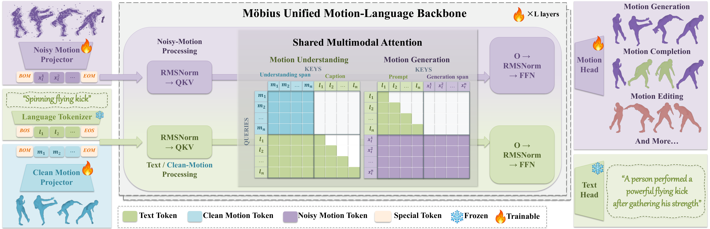

<h1 align="center">Möbius: A Unified Motion-Language Model<br>Bridging Understanding and Generation</h1>

<p align="center">
  <a href="https://jiazhishu.github.io/">Jiazhi Shu</a><sup>1,2,*</sup>, <a href="https://afterjourney00.github.io/">Chengfeng Zhao</a><sup>1,*</sup>, <a href="https://openreview.net/profile?id=~Jinyi_Wang2">Jinyi Wang</a><sup>2,†</sup>, <a href="https://knoxzhao.github.io/">Yubo Zhao</a><sup>1,2</sup>, <a href="https://people.csail.mit.edu/frankzydou/">Zhiyang Dou</a><sup>3</sup>,<br>
  <a href="https://li-ronghui.github.io/">Ronghui Li</a><sup>2</sup>, <a href="https://openreview.net/profile?id=~Yu_Lu6">Yu Lu</a><sup>2</sup>, <a href="https://openreview.net/profile?id=~Xinwei_Jiang1">Xinwei Jiang</a><sup>2</sup>, <a href="https://openreview.net/profile?id=~Zijiao_Zeng1">Zijiao Zeng</a><sup>2,‡</sup>, <a href="https://liuyuan-pal.github.io/">Yuan Liu</a><sup>1,‡</sup>
</p>
<p align="center">
  <sup>1</sup>The Hong Kong University of Science and Technology · <sup>2</sup>Tencent Games Motus · <sup>3</sup>Massachusetts Institute of Technology<br>
  <sub>* Equal contribution. &nbsp; † Project lead. &nbsp; ‡ Corresponding authors.</sub>
</p>
<p align="center">
  <a href="https://jiazhishu.github.io/mobius/">Project Page</a> ·
  <a href="https://jiazhishu.github.io/mobius/#demo-video">Demo Video</a> ·
  <a href="assets/pipeline.pdf">Pipeline (PDF)</a>
</p>

## Code Availability

Code availability is currently under internal review. Any updates regarding potential public access will be shared here.

## Overview

**Möbius** is a unified motion-language model that bridges human motion understanding and generation. A shared multimodal backbone supports text-to-motion generation, motion-to-text understanding, motion completion, and instruction-guided motion editing.

## Pipeline

[](assets/pipeline.pdf)

Text, clean motion, and noisy motion are processed through a unified backbone with shared multimodal attention. Motion and text heads support bidirectional modeling between language and human motion.

See the [project page](https://jiazhishu.github.io/mobius/) for interactive examples and results.

## Citation

If you find our work useful, please consider citing our paper.

```bibtex
@misc{shu2026mobius,
  title = {{M{\"o}bius}: A Unified Motion-Language Model Bridging Understanding and Generation},
  author = {Jiazhi Shu and Chengfeng Zhao and Jinyi Wang and Yubo Zhao and Zhiyang Dou and Ronghui Li and Yu Lu and Xinwei Jiang and Zijiao Zeng and Yuan Liu},
  year = {2026},
  eprint = {2611.05279},
  archivePrefix = {arXiv},
  primaryClass = {cs.CV},
  url = {https://arxiv.org/abs/2611.05279}
}
```
